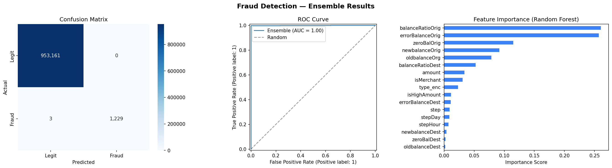
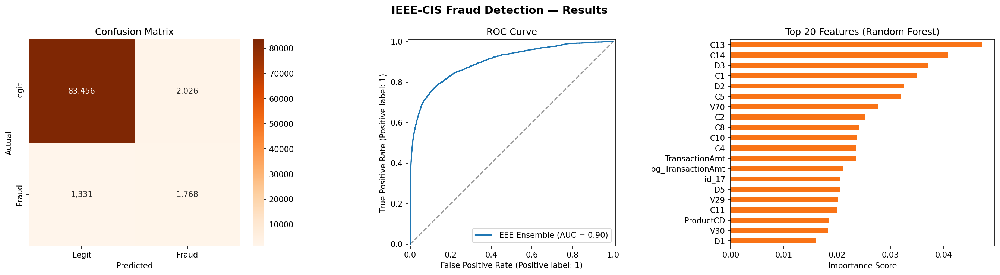
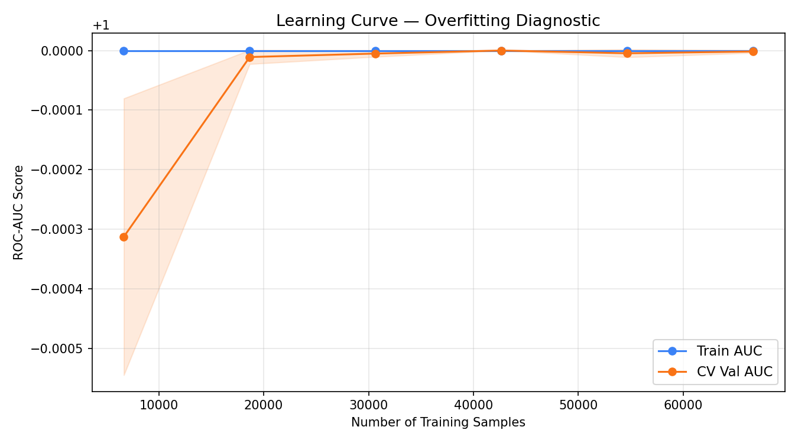

# 🛡️ VaultAI — AI-Powered Fraud Detection System

An intelligent banking fraud detection system that leverages machine learning and anomaly detection to identify suspicious financial transactions and unusual behavioral patterns.

VaultAI explores AI-driven approaches to financial security by combining predictive models with anomaly detection techniques.

---

## 📌 Overview

Financial fraud continues to evolve, making it increasingly difficult for traditional detection systems to identify suspicious activity.

VaultAI uses machine learning algorithms to analyze financial transaction data, detect potentially fraudulent patterns, and identify anomalies. The project experiments with multiple ML models across financial fraud datasets to explore more intelligent fraud detection approaches.

## ✨ Features

- 🤖 Machine learning-based fraud classification
- 🌲 Random Forest classification
- ⚡ Gradient Boosting classification
- 🔍 Isolation Forest anomaly detection
- 🧹 Data preprocessing and feature transformation
- 📊 Model experimentation and performance visualization
- 💻 Interactive React-based banking interface
- 📁 Experiments using PaySim and IEEE-CIS fraud datasets

## 🧠 Machine Learning Models

| Model | Application |
|---|---|
| Random Forest | Classifies transactions based on learned fraud patterns |
| Gradient Boosting | Learns complex patterns for fraud classification |
| Isolation Forest | Detects unusual transaction behavior and anomalies |


## 🛠️ Tech Stack

**Frontend**
- React.js
- JavaScript
- CSS

**Backend**
- Python
- FastAPI

**Machine Learning**
- Scikit-learn
- NumPy
- Pandas
- Random Forest
- Gradient Boosting
- Isolation Forest

**Development Tools**
- Jupyter Notebook
- Git
- GitHub

## 📂 Project Structure

```text
VaultAI/
├── backend/
│   ├── main.py
│   ├── random_forest.pkl
│   ├── gradient_boost.pkl
│   ├── isolation_forest.pkl
│   ├── scaler.pkl
│   ├── imputer.pkl
│   └── ...
│
├── frontend/
│   └── banking-ui/
│       ├── public/
│       ├── src/
│       ├── package.json
│       └── ...
│
├── fraud_detection.ipynb
├── ieee_fraud.ipynb
├── fraud_results.png
├── ieee_results.png
├── learning_curve.png
├── .gitignore
└── README.md
```

## 🚀 Getting Started

### Prerequisites

- Python 3.10+
- Node.js and npm
- Git

### 1. Clone the repository

```bash
git clone https://github.com/Lohitha0-0/VaultAI.git
cd VaultAI
```

### 2. Set up the Python backend

Create a virtual environment:

```bash
python -m venv fraud_env
```

Activate it on Windows:

```powershell
.\fraud_env\Scripts\Activate.ps1
```

Install dependencies:

```bash
pip install fastapi uvicorn pandas numpy scikit-learn
```

Start the backend:

```bash
cd backend
uvicorn main:app --reload
```

Backend URL:

`http://127.0.0.1:8000`

API documentation:

`http://127.0.0.1:8000/docs`

### 3. Set up the React frontend

Open a new terminal from the project root.

```bash
cd frontend/banking-ui
npm install
npm start
```

Frontend URL:

`http://localhost:3000`

## 📊 Model Results

### PaySim Fraud Detection



### IEEE-CIS Fraud Detection



### Learning Curve



## 🔮 Future Enhancements

- Real-time transaction monitoring
- Explainable AI for fraud predictions
- Advanced behavioral anomaly detection
- Fraud risk scoring
- Model performance monitoring
- Cloud deployment and containerization

## ⚠️ Disclaimer

VaultAI is an academic and experimental project intended for educational and research purposes. Its predictions should not be used as the sole basis for real-world financial decisions.

## 👩‍💻 Author

**Lohitha Reddy Marri**

[GitHub Profile](https://github.com/Lohitha0-0)

---

⭐ If you find this project interesting, feel free to star the repository!
